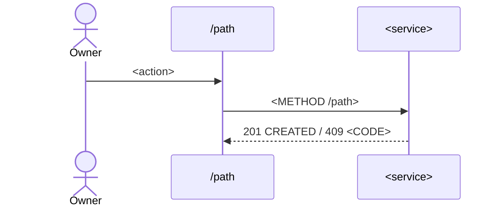

# Spec: <Feature title>

**Prefix:** `XXX` · **Status:** 📝 Draft · **Version:** v<X.Y.Z> · **Author:** <name>
**Tables:** [`table_a`](../../data-dictionary/<file>.md#table_a), [`table_b`](../../data-dictionary/<file>.md#table_b)
**Endpoints:** [api/<service>.md § <section>](../../api/<service>.md#<section>) · new ones listed in §9
**Routes:** `/path` (who) · `/path/[id]` (who)

<!--
HOW TO WRITE THIS FILE (delete nothing below; replace the <placeholders>)
- Status is one of: 📝 Draft · ✅ Approved · ⟳ Amending. Only /sdd:clarify sets ✅; only /sdd:amend sets ⟳.
- An ID is DEFINED where it starts a list item or table row in bold: `- **XXX-R01** …` or `| **XXX-D01** | …`.
  Anywhere else, write it plain (XXX-R01) — that's a reference. sddtool.py relies on this.
- IDs are never renumbered or reused. Withdraw by striking through: `- ~~**XXX-R07**~~ withdrawn in v5.3.0 — <why>`.
- One requirement = one testable sentence: who, when, what happens, which message. Long rules get several IDs.
- Values (limits, lengths, enums) come from the data dictionary. Quote the field, don't restate its type.
- Section numbers (§1 … §10, and §4a, §4b …) are stable once approved: other docs link to them.
-->

## 1. Summary and scope

<One paragraph: the problem for the SME owner / branch manager, and what this feature does about it.>

- **In:** <journeys covered>
- **Out:** <what this spec deliberately doesn't do, and where it lives if elsewhere>
- **Depends on:** <other specs, by slug and ID, e.g. `authentication` AUT-R04>

## 2. Roles and branch scope

| Role | Can | Scope |
|---|---|---|
| `BUSINESS_OWNER` | <…> | All branches, or one when switched |
| `BRANCH_MANAGER` | <…> | Locked to `users.branch_id` |

<Business-wide rows (`branch_id` null), deactivated users, soft-deleted rows — say how each is handled, or reference the requirement that does.>

## 3. Decisions

| ID | Topic | Decision |
|---|---|---|
| **XXX-D01** | <topic> | <what was decided; for a 📝 draft write "Proposal: …"> |

## 4. Journeys

> Diagrams are Mermaid. Steps marked *server* are simulated by the web-ui mock until the endpoint exists.

### 4a. <Journey name>

<Short notes. Point at the requirements this journey realises: XXX-R01, XXX-R02.>

## 5. Requirements

Grouped by journey. The `§` after the role links back to §4.

### <Journey name> (§4a)

- **XXX-R01** · Owner · §4a — <When …, the system …>.
- **XXX-R02** · Owner, Manager · §4a — <…> Shows XXX-M01.

### Fields

| Field | Rule (from the data dictionary) | Requirement |
|---|---|---|
| `table.field` | <required, length, unique — quoted> | XXX-R03 |

## 6. Messages

Every user-visible message and error code, once. Requirements reference these IDs.

| ID | HTTP · code | Text (English; Khmer later) | Used by |
|---|---|---|---|
| **XXX-M01** | `409 · <CODE>` | "<message>" | XXX-R02 |

## 7. Edge cases

Every case from the `identify-edge-cases` categories that applies, with the expected result.

- **XXX-E01** · Actions — <two users save the same record> → <expected result, message XXX-M0n>.
- **XXX-E02** · Permissions — <a manager opens another branch's id by URL> → <404 / redirect>.

## 8. Data dictionary changes

| Table.field | Change | Why | State |
|---|---|---|---|
| `table.field` | <add / change / remove …> | XXX-R0n | proposed |

State is `proposed` until /sdd:clarify applies it to `data-dictionary/`, then `applied in v<X.Y.Z>`. A spec never silently changes a field.

## 9. Endpoints

| Method · path | Service | Who | Requirements | In api/? |
|---|---|---|---|---|
| `POST /path` | <service> (TRD §1a) | Owner | XXX-R01 | 📝 planned / ✅ listed |

## 10. Questions

Open questions block approval. When answered, the line gets `→ XXX-Dnn` and the decision goes in §3.

- **XXX-Q01** · §4a — <question?> *Options:* (a) <…> — <trade-off>; (b) <…> — <trade-off>. *Suggested:* <option, only if the docs lean that way, and where>.
- **XXX-Q02** · §2 — <question?> → XXX-D03 (answered <date> by <name>)
